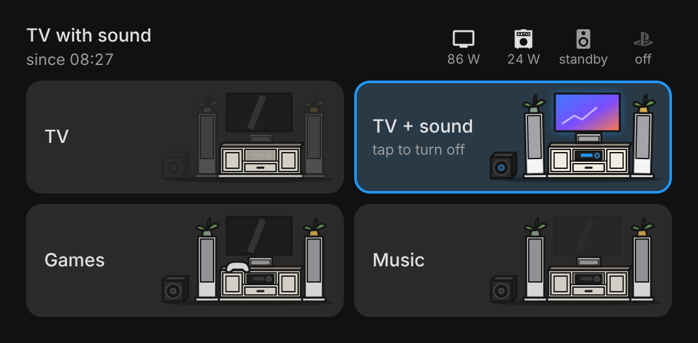

# Media Wall Card

A Home Assistant dashboard card for choosing the living room audio / TV mode: TV, TV with sound, Games, Music (and optionally Movie). One button per mode, each with a line drawing of the media wall that lights up the devices the mode uses, a short status line, and small indicators for the smart plugs that show what is really on, so you see at once when reality differs from the mode.



Made for modes that are power combinations of a few smart plugs (TV, receiver, subwoofer, PlayStation), set by a script that stores the current mode in an `input_text`. The card calls that script; it never switches a plug itself. It replaces four Mushroom template cards restyled with card_mod. One JavaScript file, no dependencies, no Mushroom or card_mod.

## What it shows

| Part | Shows |
|---|---|
| Title | The mode: `TV with sound`, `All off`, or the raw value if the script set something the card does not know. `Unavailable` in amber when the state entity is |
| Status line | `since 17:45` (when the mode last changed; `since Tue 17:45` earlier this week, `since Nov 4` before that), then what is going on: `switching to Music`, `turning off`, `Music: no response` (amber, for 6 s), then the first mismatch in amber with a count: `PS is off`, `TV is on · +1`, `Amp offline` |
| Plug indicators | Icon and power per plug: `86 W`, `standby` (on but below `standby_below`), `off`, `on` (no power sensor), `n/a` with a red badge (unavailable). A plug that does not match the mode gets an amber outline |
| Mode buttons | 2 × 2 (a fifth mode takes a full width third row). The active mode has a coloured border and tint and `tap to turn off`. The drawing shows the mode's devices in full and ghosts the rest; in the active mode they light up and move: TV picture (with ambient glow when sound is on), receiver display, the towers sway from their foot, the centre speaker leans in and out, the sub hops and its driver pumps, the controller lights, music notes float. All motion stops under reduced motion |
| While switching | The pressed button gets a dashed border and `switching…` until the state follows (or a plug changes). After `busy_timeout` seconds without a change it goes back and the line says `no response` |

Mismatches: a plug that should be on for the mode but is off (`Amp is off`), or on but should be off (`TV is on`, also in All off). The card waits 5 seconds after a mode change before it compares, because the plugs follow the script one by one. Unavailable plugs are always flagged.

## Using it

| Do | Result |
|---|---|
| Tap a mode | Calls the script with the mode id: `perform-action: script.audio_management_lovelace`, `data: { actionid: Music }`. The script sets the mode |
| Tap the active mode | The same call; the script turns everything off when the mode is already active |
| Power button (`off_button: true`) | Calls the script with `off_id` (`Off`). Disabled while all is off |
| Tap a plug indicator | More-info of that plug's switch |
| Tap the title or status line | More-info of the state entity (history of the modes) |

No confirmation dialogs. Every action goes through Home Assistant's own action handler.

## Install

Home Assistant 2026.11 and newer: Settings → Marketplace → Add from link → `https://github.com/BarBaar44/media-wall-card` (type Dashboard), then Install and reload the browser. The resource is served from `/local/community/media-wall-card/media-wall-card.js`.

Older Home Assistant: HACS → three dots → Custom repositories → the same link, category Dashboard.

## Configuration

```yaml
type: custom:media-wall-card
grid_options:
  columns: 12
  rows: 4
```

That is all for the owner's own living room. Everything else is optional, in YAML or the visual editor. A misspelled option gives an error card.

| Option | Default | |
|---|---|---|
| `name` | `Living room` | for screen readers only |
| `state_entity` | `input_text.audio_state` | holds the current mode id (`input_select`, `select` and `sensor` work too) |
| `script` | `script.audio_management_lovelace` | called with the mode id |
| `field` | `actionid` | the script field that gets the mode id |
| `off_id` | `Off` | the mode id that means all off |
| `movie` | `false` | adds the Movie mode to the default modes |
| `off_button` | `false` | a power button in the header |
| `picture` | `true` | `false`: the mode icon instead of the drawing |
| `standby_below` | `3` | W: a plug that is on but draws less is shown as standby |
| `busy_timeout` | `5` | seconds the pressed button waits for the state to follow |
| `modes` | see below | |
| `plugs` | see below | |
| `colors` | `active` blue, `warn` orange, `error` red | any CSS colour |

### Plugs

| `id` | `name` | `switch` | `power` | `icon` |
|---|---|---|---|---|
| `tv` | TV | `switch.tv_switch` | `sensor.tv_power` | `mdi:television` |
| `amp` | Amp | `switch.amplifier_switch` | `sensor.amplifier_power` | `mdi:amplifier` |
| `sub` | Sub | `switch.subwoofer_switch` | `sensor.subwoofer_power` | `mdi:speaker` |
| `ps` | PS | `switch.playstation_switch` | `sensor.playstation_power` | `mdi:sony-playstation` |

A `plugs` list replaces these. `switch` is required; `power: null` (or leaving it out with your own switch) means no power sensor. The visual editor shows the switch and power sensor of the first four plugs.

### Modes

| `id` | `name` (button) | `label` (title) | `on` |
|---|---|---|---|
| `TV` | TV | TV | `[tv]` |
| `TVS` | TV + sound | TV with sound | `[tv, amp, sub]` |
| `Games` | Games | Games | `[tv, amp, sub, ps]` |
| `Music` | Music | Music | `[amp, sub]` |
| `Movie` (with `movie: true`) | Movie | Movie | `[tv, amp, sub]` |

`id` is the value the script sets in the state entity and gets as `actionid`. `on` lists the plugs that should be on in this mode: it drives the mismatch check and which devices the drawing shows (`tv` the TV, `amp` the receiver and speakers, `sub` the subwoofer cube on the floor, `ps` the controller). Each mode can have an `icon` (shown with `picture: false`) and a `color` for its highlight. A `modes` list replaces the defaults; it is edited in YAML (the visual editor keeps it). A full example is in [`media-wall-card.yaml`](media-wall-card.yaml).

## Design decisions

| Decision | Why |
|---|---|
| One card, 12 × 4, always 2 × 2 | the same space as the four 6 × 2 Mushroom cards it replaces, so nothing else on the dashboard moves; buttons are 244 × 87 at 520 px and 164 × 87 at 360 px |
| The script does the switching | the script also runs from automations ("Go to bed", "Shutdown when away") and keeps `input_text.audio_state` right; one place for the logic |
| Tap active = off, no confirmation | that is how the script works and how the old buttons worked; the hint on the active button says so |
| Plug indicators next to the mode | the mode is what the script last set; the plugs are what is really on. A plug toggled by hand or an unavailable plug shows at once |
| 5 second grace before a mismatch | the script switches the plugs one after another; without it every mode change would flash a warning |
| Busy until the state or a plug changes | tapping the active mode when the state already says Off changes no state, only plugs |
| Drawing of the real media wall | the same line art family as Gardenview House and Irrigation; ghosting shows which devices a mode uses even when it is off |
| On a phone the label moves to the top left and the hint is hidden | at 164 px wide the label and drawing do not fit side by side |

## Development

`npm install`, then `npm test` (jsdom). Check layout changes in a real browser at 360 and 520 px section width; the card is 248 px high (12 × 4).

MIT licence.
